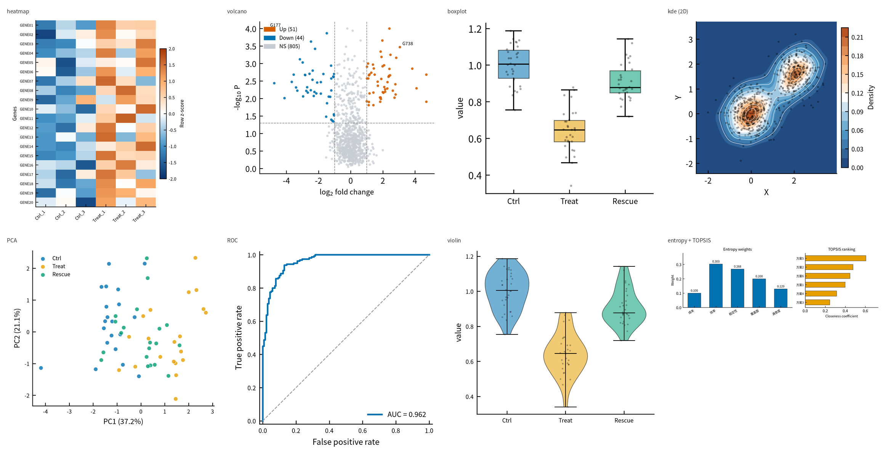

# oplot

**给科研人用的出图工具：热图 / 火山图 / 箱线图 / 核密度 / 熵值法 TOPSIS / PCA / ROC / 小提琴。**

一条命令出一张能投稿的图（300 DPI PNG），不需要记 matplotlib 的细节。



---

## 装

```bash
pip install numpy pandas matplotlib scipy scikit-image
```

（或用你自己的 venv）

然后：

```bash
git clone <this-repo>
cd opensci-plot
```

---

## 一键看效果

```bash
./demo.sh          # 输出到 out/
./demo.sh mydir/   # 输出到 mydir/
```

脚本会自动找带 numpy/pandas/matplotlib/scipy 的 python。

---

## 用

```bash
python -m oplot.cli heatmap examples/expression.csv out/
python -m oplot.cli volcano examples/deg.csv        out/
python -m oplot.cli boxplot examples/groups.csv     out/
python -m oplot.cli kde     examples/points.csv     out/
python -m oplot.cli entropy examples/matrix.csv     out/
python -m oplot.cli pca     examples/pca.csv        out/
python -m oplot.cli roc     examples/roc.csv        out/
python -m oplot.cli violin  examples/groups.csv     out/
```

输出：

| 命令 | 文件 |
|---|---|
| `heatmap` | `heatmap.png` |
| `volcano` | `volcano.png` |
| `boxplot` | `boxplot.png` |
| `kde` | `kde2d.png`（三列时还有 `kde3d.png`） |
| `entropy` | `fig.png` / `weights.csv` / `scores.csv` |
| `pca` | `pca.png` |
| `roc` | `roc.png` |
| `violin` | `violin.png` |

---

## 输入格式

**heatmap** — 行=基因，列=样本，第一列是行名：

```csv
, Ctrl_1, Ctrl_2, Treat_1, Treat_2
GENE01, 8.2, 7.9, 9.4, 9.1
GENE02, 7.5, 8.0, 8.8, 9.3
```

**volcano** — 要有 `log2FC` 和 `pvalue`（或 `padj`）：

```csv
gene, log2FC, pvalue
G001, 1.82, 0.0003
G002, -1.24, 0.0021
```

**boxplot** — 要有 `group` 和 `value`：

```csv
group, value
Ctrl, 1.02
Treat, 0.61
```

**kde** — 两列 `x,y`（二维），或三列 `x,y,z`（三维）：

```csv
x, y
0.12, -0.35
1.87, 1.42
```

**entropy** — 第一列是方案名，其余列是指标（默认全部正向）：

```csv
方案, 成本, 效率, 稳定性
方案1, 62.3, 48.1, 55.0
方案2, 41.8, 66.2, 51.3
```

**pca** — 行=样本，列=特征；非数值列（优先叫 `group`/`cluster`/`label`）自动当分组上色：

```csv
sample, group, F1, F2, F3
S1, Ctrl, 0.21, -1.02, 0.88
S2, Treat, 2.11, 0.44, 1.92
```

**roc** — 两列 `y_true`(0/1) 和 `y_score`；AUC 手算，不依赖 sklearn：

```csv
y_true, y_score
0, 0.21
1, 0.87
```

---

## 图形风格

- **色盲友好**：Okabe-Ito 配色（蓝 `#0072B2` / 橙 `#E69F00` / 绿 `#009E73` / 红 `#D55E00`）
- **打印友好**：无衬线字体、内向刻度、细轴线
- **300 DPI**：`bbox_inches='tight'` + 白底
- **中文**：自动用 `Noto Sans CJK SC`（没装会 fallback）

---

## 当库用

```python
from oplot.omics import heatmap, volcano, boxplot
from oplot.kde import kde2d, kde3d
from oplot.entropy import entropy_weight, topsis

heatmap('expression.csv', 'my_heatmap.png', top=50)
```

---

## 为什么会有这个

写论文的时候，每次都要重新调字体、配色、边距、DPI。

这套脚本是那些调参的**沉淀**：颜色定死、尺寸定死、能跑就行。

---

## License

MIT
